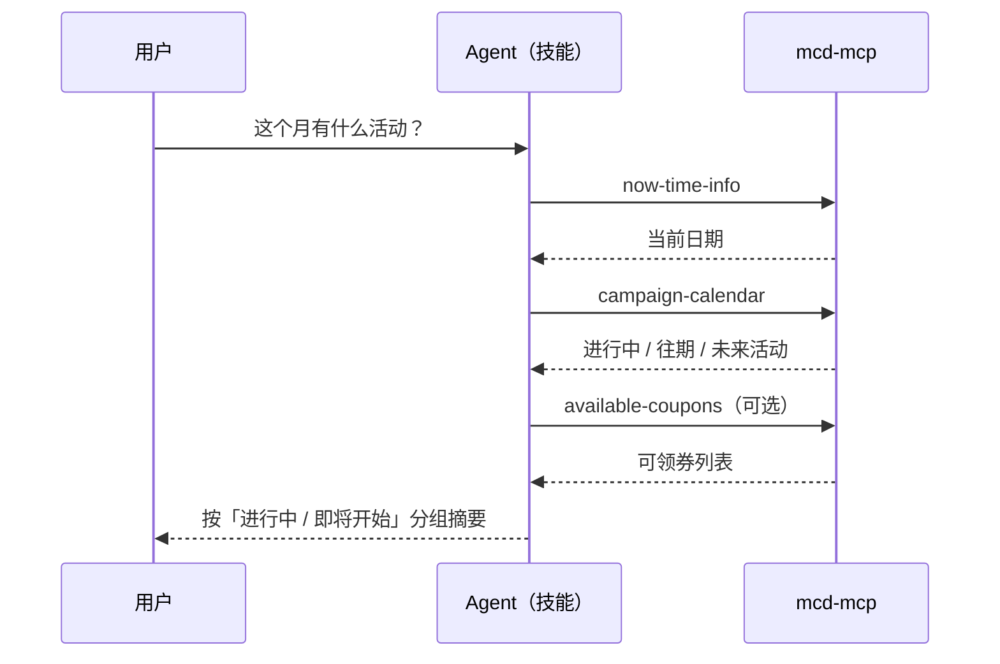
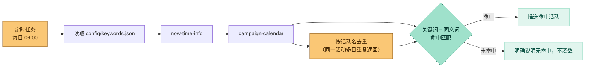
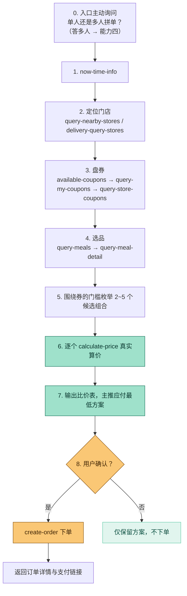
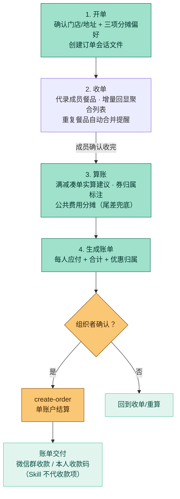

# MCP 集成说明

本文档说明 `mcd-cn-assistant` 实际使用的**麦当劳 MCP Server**、**Tool**、**调用流程**与**业务价值**。

---

## 一、使用的 MCP Server

| 项目 | 值 |
|---|---|
| Server 名称 | `mcd-mcp` |
| 接入地址 | `https://mcp.mcd.cn` |
| 提供方 | 金拱门（中国）有限公司（麦当劳中国） |
| 传输协议 | Streamable HTTP（不支持 WebSocket） |
| 鉴权方式 | 请求头 `Authorization: Bearer <你的 MCP Token>` |
| 支持版本 | MCP 协议 `2025-06-18` 及之前版本 |
| 工具总数 | 35 个（2026-10-09 对线上 `tools/list` 实测核对） |
| 限流 | 每 Token 600 次/分钟，超限返回 `429` |
| 服务范围 | 中国大陆（不含港澳台） |

本项目**只接入官方远程托管服务**，未使用任何第三方代理地址，不含任何本地 MCP 进程。脱敏配置见 [`mcp-config.example.json`](./mcp-config.example.json)（仅使用环境变量占位符 `${MCD_MCP_TOKEN}`）。

---

## 二、实际使用的 Tool

按"职责"分两类标注：**只读**（查询，可自主调用）与**写操作**（改变账户状态或产生费用，必须先经用户明确同意）。

### 2.1 能力一 · 最新活动推送

| Tool | 用途 | 类型 |
|---|---|---|
| `now-time-info` | 获取当前完整时间，作为一切日期推理的基准 | 只读 |
| `campaign-calendar` | 查询当月营销活动日历（进行中 / 往期 / 未来） | 只读 |
| `available-coupons` | 麦麦省当前可领取的优惠券列表 | 只读 |
| `query-my-coupons` | 用户账户下已有的优惠券 | 只读 |

### 2.2 能力二 · 联名关注推送

| Tool | 用途 | 类型 |
|---|---|---|
| `now-time-info` | 取得当前日期 | 只读 |
| `campaign-calendar` | 拉取当月活动作为关键词匹配语料 | 只读 |
| `available-coupons` | 补充券类活动信息 | 只读 |

> **同义词必须含「联动」**（2026-10-13 实测修正）：麦当劳对 IP 合作的官方文案常写「联动」而非「联名」（如「麦当劳联动G-DRAGON」）。缺这个词会把整条联名活动漏推，而它的联名食品在菜单里本可代点。残留边界：同系列活动但标题与描述均不含关键词的（如「韩式风味蘸酱」仅描述含"getGD同款"）仍不命中，此时回退到当日全量日历逐条讲，**不要**为它放宽到「同款」等过泛词。

> **`campaign-calendar` 会重复返回同一条活动，必须去重**（2026-10-17 实测）：同一条活动按排期日 / 结束日出现多次（当日实测：棒球帽 10-13 与 10-17 各行一次、G-DRAGON 10-16 与 10-17 各行一次、韩式风味蘸酱 10-17 与 10-18 各行一次）。不加去重会让用户收到重复推送。规则：按活动名去重，同一活动只保留一行，状态取"进行中 > 即将开始 > 往期"最高优先级；往期一律不推。

> **联名周边可以直接代买**（2026-10-16 实测修正，**推翻 10-13 的错误结论**）：周边以普通可售商品出现在 `query-meals` 里（实测编码 `521954` 联名复古棒球帽、`521955` 联名徽章、`521743` 薯条脆卜卜毛绒周边），`discountType="随单购麦金卡优惠"`、带 `withOrder: {membershipCode:"106", specId:"880"}`。加购 `521234 麦金卡体验卡（15 天）¥9.90` 后周边降 ¥5、配送费与打包费归零，**实测净省 ¥1.10～¥12.10**（如帽子：不加卡 ¥45.90 / 加卡 ¥44.80）。`calculate-price` 会自动把体验卡与归零费用写进 `productList`，照抄返回值即可。周边**随门店和渠道变化**，必须先扫再下结论。MCP 做不到的是**实时库存查询**与**持续补货监控**（无库存接口）、**积分商城换周边**（类目 `2>8` 实测全部过期）。⚠️ 10-13 曾据"上海一家门店的到店菜单"误判"周边无法通过 MCP 购买"，教训：菜单能力必须按「门店 × 渠道」分别实测。

> **`create-order` 的 `remark` 备注字段仅 `orderType=2`（外送）可用、最多 50 字**（2026-10-16 实测）。这是小红书"隐藏吃法"里免费配件（多要两包番茄酱 / 糖 / 胡椒粉 / 奶球）的唯一注入通道；到店自取单没有备注入口，只能给用户到店话术。这类配件**不是商品、无法加购**。

> **外送菜单的商品编码与到店不同**（2026-10-16 实测）：巨无霸 到店 `1100` / 外送 `901100`，麦香鸡 `1450` / `901450`。用错编码会让 `calculate-price` 返回 `price:0`、`productList` 为空——与"券专享商品没带券"现象相同但根因不同，排查时先确认编码来源渠道。

> **`query-meal-detail` 的 `modification` 特调**可在商品级与套餐子项级取消酱料（巨无霸 `100116`、麦香鱼 `100126`）、改冰量、换燕麦奶（+¥2）、加奶油球 / 白砂糖（price 0）。key 规则：选中用 `selectedKey`，未选且该组有 `unselectedKey` 的项**也必须一并传入**。⚠️ `calculate-price` **不回显特调结果**，只能确认不报错。

> **`list-nutrition-foods` 无入参**，一次返回全表约 180 项（`energyKcal / protein / fat / carbohydrate / sodium / calcium`），是参数化营养搭配的数据源。表按**标准份**计，改特调后热量不会自动重算。

> **MCP 无门店库存接口、无天气接口，也抓不到小红书链接内容**（2026-10-16 实测，抓取 `xiaohongshu.com/explore/...` 只返回登录墙）。这三类是明确的能力边界，相关功能按文档降级路径处理，不得编造库存数字、气温降雨或笔记内容。

### 2.3 点餐统一入口（能力三 / 四 共用）

| 阶段 | Tool | 用途 | 类型 |
|---|---|---|---|
| 入口询问 | （无工具调用） | 澄清需求后、定位门店**前**，Agent **主动询问**"单人还是多人拼单"，据此分流到 2.4 能力三或 2.5 能力四 | — |

> 这是**纯本地交互规则**，不消耗 MCP 调用。多人拼单能力**不依赖用户自己提出**——入口必问，是能力四最主要的触发路径；回答含糊时再确认一次，不默认按单人处理。

### 2.4 能力三 · 最优惠点餐

| 阶段 | Tool | 用途 | 类型 |
|---|---|---|---|
| 定位门店 | `query-nearby-stores` | 按地址查附近可到店取餐的门店 | 只读 |
| 定位门店（外送） | `delivery-query-addresses` | 查询用户已保存的配送地址 | 只读 |
| 定位门店（外送） | `delivery-query-stores` | 按收货地址查可配送门店 | 只读 |
| 定位门店（外送） | `delivery-create-address` | 新增配送地址 | **写操作** |
| 团餐 | `query-meal-assistance` | 查询门店支持的助餐服务 | 只读 |
| 盘券 | `available-coupons` | 麦麦省可领券 | 只读 |
| 盘券 | `auto-bind-coupons` | 一键领取麦麦省全部可领券 | **写操作** |
| 盘券 | `query-my-coupons` | 账户已有券 | 只读 |
| 盘券 | `query-store-coupons` | 当前门店可用券 | 只读 |
| 选品 | `query-meals` | 门店在售菜单（分类 / 编码 / 标签 / 优惠价） | 只读 |
| 选品 | `query-meal-detail` | 套餐组成、可替换与换购选项 | 只读 |
| 算价 | `calculate-price` | 按商品列表（可含券）计算商品金额 / 配送费 / 打包费 / 优惠 / 应付总价 | 只读 |
| 下单 | `create-order` | 创建订单，返回订单详情与支付链接 | **写操作** |

### 2.5 能力四 · 多人群点聚合

| 阶段 | Tool | 用途 | 类型 |
|---|---|---|---|
| 开单/收单 | `now-time-info` | 会话时间基准（订单会话文件名、账单日期） | 只读 |
| 开单/收单 | `query-nearby-stores` / `delivery-query-addresses` / `delivery-query-stores` | 定位就餐门店与配送地址（与能力三共用） | 只读 |
| 收单 | `query-meals` / `query-meal-detail` | 取每件代录餐品的**真实单价**（禁止记忆价） | 只读 |
| 算账 | `available-coupons` / `query-my-coupons` / `query-store-coupons` / `query-promotions` | 盘点满减档位与**下单人账户**可用券 | 只读 |
| 算账 | `calculate-price` | 满减凑单方案实算验证 + 含券含公共费用（配送费 + 打包费）的最终应付（分摊基准） | 只读 |
| 成单 | `create-order` | 组织者确认账单后单账户下单 | **写操作** |

> 代录成员餐品、重复合并提醒、满减凑单判定、券归属标注、公共费用分摊（配送费 + 打包费，含尾差兜底）与账单生成均在技能本地完成，数据结构见 [`references/group-order.md`](./references/group-order.md)，不额外消耗 MCP 调用。

### 2.6 辅助能力

| Tool | 用途 | 类型 |
|---|---|---|
| `list-nutrition-foods` | 餐品营养成分，用于热量 / 营养搭配场景 | 只读 |
| `query-order` / `order-list` | 查订单进度与近期历史订单 | 只读 |
| `cancel-order` | 取消订单 | **写操作** |
| `query-my-account` | 积分账户信息 | 只读 |
| `mall-points-products` / `mall-product-detail` | 麦麦商城商品与详情 | 只读 |
| `mall-create-order` | 积分兑换商品下单 | **写操作** |
| `mall-order-list` / `mall-order-detail` | 商城订单查询 | 只读 |
| `query-lottery-info` | 积分抽奖活动信息 | 只读 |
| `draw-lottery` | 执行积分抽奖 | **写操作** |
| `query-my-prizes` | 我的奖品记录 | 只读 |
| `query-party-city` / `query-party-store` / `query-party-store-date` / `query-party-store-session` | 主题活动城市 / 门店 / 日期 / 场次查询 | 只读 |
| `party-order-create` | 主题活动订单创建 | **写操作** |

完整工具速查（含参数要点与错误码）见 [`references/mcd-tools.md`](./references/mcd-tools.md)。

### 2.7 小红书场景六项（2026-10-16 新增）

| 能力 | 使用的 Tool | 关键约束 |
|---|---|---|
| ⑤ 隐藏吃法一键还原 | `query-meals` → `query-meal-detail`（读 `modification`）→ `calculate-price` → `create-order`（带 `remark`） | `remark` **仅外送单、≤50 字**；免费配件不是商品、无法加购；特调按 `selectedKey`/`unselectedKey` 规则传参，且算价接口不回显特调结果 |
| ⑥ 穷鬼套餐演算 | `query-my-coupons` + `query-store-coupons` + `available-coupons` → `query-meals` → 多候选 `calculate-price` | 到店单基本无满减档位；无档位就明说，不臆造；凑单建议必须整体实算自证 |
| ⑦ 周边联名抢货雷达 | `query-nearby-stores` / `delivery-query-stores` → **逐门店** `query-meals` → `calculate-price`（带与不带 `withOrder` 各一次）→ `create-order` | **无库存接口、无法持续监控**；周边随门店和渠道变化；麦金卡随单购常反而更省 |
| ⑧ 参数化营养搭配 | `list-nutrition-foods`（无入参，一次全表）→ `query-meals` → `query-meal-detail` → `calculate-price` | 营养表按标准份计，特调不自动重算热量，结论只给约数 |
| ⑨ 晒单卡片生成 | **无 MCP 调用**，用已获得的订单与营养数据本地生成 SVG / HTML | 数字必须来自 `calculate-price` 与 `list-nutrition-foods`，没查过就不写 |
| ⑩ 天气与场景感应推送 | `now-time-info`（日期 / 星期 / 时刻）→ 可选 `campaign-calendar` / `available-coupons` | **无天气数据源**；天气需用户自述，不编造 |

详细词典、算法与模板见 [`references/xhs-playbook.md`](./references/xhs-playbook.md)。

---

## 三、调用流程

### 3.1 能力一 · 最新活动推送

### 3.2 能力二 · 联名关注推送

> `campaign-calendar` 会按排期日 / 结束日把同一活动**重复返回**（实测 2026-10-17：棒球帽在 10-13 与 10-17 各行一次、G-DRAGON 在 10-16 与 10-17 各行一次），因此**去重是必需步骤**而非优化：同一活动名只保留一行，状态按"进行中 > 即将开始 > 往期"取最高优先级，往期一律不推。

### 3.3 能力三 · 最优惠点餐（核心链路）

**流程要点**

1. **券先于菜**：先盘清"有哪些券"，再围绕券的门槛去选品，而不是先选品再找券——这是"最优惠"的前提。
2. **算价靠工具不靠模型**：候选组合**逐个**送入 `calculate-price`，以其返回的"应付总价"排序。券面文字（如"第二份半价"）不等于真实优惠，必须实算验证。
3. **限流友好**：候选组合控制在 2~5 个，串行调用，同一门店的菜单与券在一轮会话内复用。

### 3.4 能力四 · 多人群点聚合

**入口**：能力四通常**不是**用户主动喊出来的，而是**点餐入口询问的回答**（见 2.3）——点餐请求在定位门店前先问"单人还是多人拼单"，答多人即进入本流程。

**流程要点**：MCP 为单账户鉴权，能力四为**组织者模式**——成员餐品由下单人代录，统一用下单人账户结算；**严禁**模拟登录他人账号；收款环节由组织者完成，Skill 只产出账单。

---

## 四、业务价值

### 4.1 解决的核心问题

麦当劳官方 MCP 提供 35 个**原子工具**，但原子能力不等于可用的助手。用户的真实诉求是"别错过活动""点得最便宜""群点不算账"，而这三件事要求：

- **跨工具编排**：一次"最划算点餐"要串联 6~8 个工具，且顺序错一步结论就错；
- **业务规则理解**：券有门槛、限渠道、指定商品，第二份半价与满减不可叠加；
- **风险控制**：AI 一旦"顺手下单"就是真金白银的损失。

本项目把上述三点固化为**可复用的技能流程**与**硬性约束**。

### 4.2 分能力价值

| 能力 | 对用户的价值 | 对麦当劳的价值 |
|---|---|---|
| ① 最新活动推送 | 不必逐个翻 App 找活动，一句话拿到当月全量活动 | 提高活动触达率，让营销活动真正被看见 |
| ② 联名关注推送 | 把"全量噪音"变成"我关心的那几条"（默认盯联名 / 限定 / IP 合作，关键词可改），且可无人值守自动推 | 精准触达兴趣人群，提升联名/新品类活动的转化 |
| ③ 最优惠点餐 | 系统化比价替代人脑心算，拿到明确的"最省方案" | 提升券核销率与转化率，降低用户的下单决策成本 |
| ④ 多人群点聚合 | 把"刷屏报菜名 + 人肉算账 + 尴尬收钱"压缩为一张每人应付的账单（满减凑单、券归属、公共费用分摊全自动） | 单次订单客单价与件数显著放大（1 人下单 → N 人消费），凑单建议提升满减档位达成率 |
| ⑤ 隐藏吃法一键还原 | 刷到爆款吃法不用自己拆：粘贴文案或发截图，自动分清"能加购的 / 能改特调的 / 只能备注的" | 把社交平台的 UGC 热度直接转化为可执行订单；外送单备注自动补全降低沟通成本 |
| ⑥ 穷鬼套餐演算 | 用自然语言约束凑最优组合，不用人脑枚举 | 提升客单与券核销；"算得出最低价"增强价格信任 |
| ⑦ 周边联名抢货雷达 | 不用逐个 App 查哪家店有货，一键扫店并直接锁单 | 缩短联名周边的转化路径；麦金卡随单购优化提升会员卡渗透 |
| ⑧ 参数化营养搭配 | 减脂 / 控糖 / 高蛋白需求参数化，官方营养数据支撑 | 拓展健康饮食人群，提升套餐与无糖饮料选配率 |
| ⑨ 晒单卡片生成 | 一键生成可分享的卡片与文案，满足"出片"与分享欲 | UGC 二次传播，反向为活动与联名引流 |
| ⑩ 场景感应推送 | 按时段 / 星期给仪式感推荐（周五福利、夜市、早餐） | 提升闲时时段（下午茶 / 夜市）的订单转化 |

### 4.3 可量化收益

- **决策成本**：一次完整比价从"人工翻菜单+逐张核券"压缩为一次自然语言对话。
- **券核销**：把"可领券"主动纳入比价模型，避免用户"有券没用"。
- **调用效率**：候选组合数受控（2~5 个），在 600 次/分钟限流下仍可稳定完成比价。
- **周边转化**：实测麦金卡随单购在周边订单上净省 ¥1.10～¥12.10，"加卡更便宜"是可复用的确定性结论。
- **营养决策**：`list-nutrition-foods` 一次拉取全表，参数化筛选不增加 MCP 调用次数。

### 4.4 能力边界（明确不承诺的部分）

| 用户可能期待 | 实际情况 | 降级路径 |
|---|---|---|
| 实时门店库存 / 补货监控 | 35 个工具中**无任何库存接口** | 按需逐门店 `query-meals` 扫描，并说明是"查询时点在售状态" |
| 天气感知推送 | **无天气数据源** | 基于日期 / 星期 / 时段的场景推送；天气由用户自述 |
| 解析小红书链接 | **实测抓不到**（登录墙） | 引导粘贴文案或发截图（本地多模态读图） |
| 到店单加备注 | `remark` **仅 `orderType=2`** | 到店单改为给用户一句到店话术 |
| 积分商城兑换联名周边 | 类目 `2>8` 实测全部过期 | 走点餐主链路直接购买 |

---

## 五、工程约束与安全边界

### 5.1 写操作二次确认

以下工具被技能硬性约束为"**必须先向用户列清明细并获得明确同意**"后才可调用：

`create-order`、`party-order-create`、`mall-create-order`、`auto-bind-coupons`、`cancel-order`、`draw-lottery`、`delivery-create-address`

下单前必须列明的明细：门店、商品、规格、单价、优惠、配送费、打包费、**应付总额**。

### 5.2 只读推送

定时推送任务（每日 09:00）被限定为**纯只读**，其 prompt 中显式禁止调用任何写操作工具。

### 5.3 错误处理

| 错误码 | 原因 | 技能内置处理 |
|---|---|---|
| `401` | Token 无效、过期或未提供 | 引导用户检查 `Authorization` 头与配置，并确认服务已启用 |
| `429` | 触发限流（>600 次/分钟） | 降低频率、复用会话内已有结果 |

### 5.4 交互入口规则（主动询问优于被动等待）

| 规则 | 说明 |
|---|---|
| 点餐入口必问 | 任何点餐请求在定位门店前，Agent **必须主动问**"单人还是多人拼单"，**不得等用户自己提出**，也**不得默认按单人处理** |
| 只问一次 | 用户答复过（或已在同一句里说明人数）就不再追问，避免骚扰式交互 |
| 含糊则再确认 | 回答不清时**再确认一次**，而不是替你选单人 |
| 已明确单人则不推销 | 用户已说清"就我一个人"时不再提拼单 |

设计意图：**好功能不能藏在用户想不到的地方**。多人拼单如果只能被动触发，等于不存在；把它前置为点餐的必答题，才能让"算账难、下单乱、收钱烦"的场景真正被接住。

### 5.5 隐私与凭证

- 仓库与技能中**不含任何真实 Token**；示例配置仅使用环境变量占位符 `${MCD_MCP_TOKEN}`。
- `.gitignore` 已排除 `mcp.json`、`.env`、`*.token` 等本地凭证文件。
- 技能不采集、不落盘、不上传任何用户数据，无遥测代码。

---

## 六、参考

- 麦当劳 MCP Server 开放平台：<https://open.mcd.cn/mcp>
- 官方接入文档：<https://github.com/M-China/mcd-mcp-server>
- 麦当劳 MCP 服务规则：<https://cdn.mcd.cn/cms/pages/MCPServerRules.html>
- 工具速查表：[`references/mcd-tools.md`](./references/mcd-tools.md)
